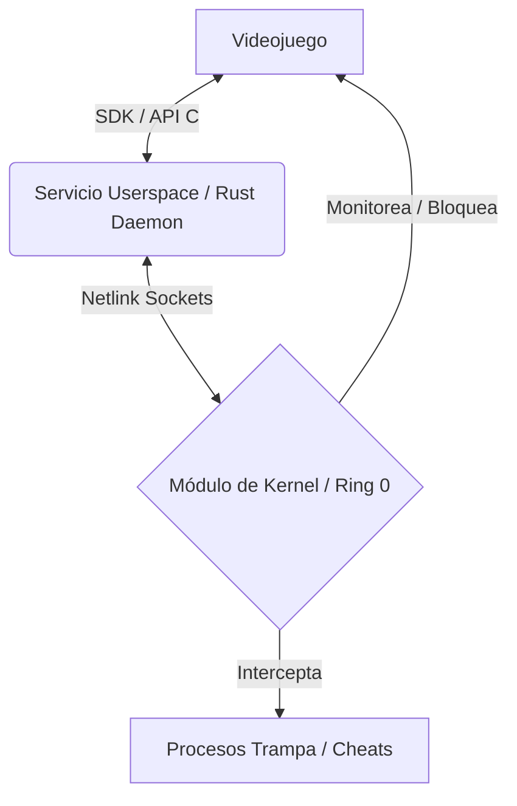

# Contexto del Proyecto: Quark Anticheat

Este documento resume el contexto y la arquitectura de **Quark Anticheat**, sirviendo como guía de referencia rápida para otros modelos de lenguaje (LLMs) y desarrolladores.

## 1. Origen del Problema
En el ecosistema de videojuegos en línea de GNU/Linux, existe una importante exclusión: muchos juegos competitivos populares exigen sistemas anticheat que funcionen a nivel de kernel (Ring 0). Dado que los anticheats comerciales más comunes (como Easy Anti-Cheat o BattlEye) se desarrollan para Windows y no cuentan con un controlador nativo equivalente para Linux, estos juegos no se pueden ejecutar en distribuciones Linux, ni siquiera bajo capas de traducción como Proton (donde el anticheat corre únicamente en espacio de usuario sin privilegios de kernel).

**Quark Anticheat** nace como una propuesta académica e investigativa para demostrar la viabilidad técnica de una solución nativa de nivel de kernel (Ring 0) en GNU/Linux.

## 2. Objetivos Principales
* **Demostrar la viabilidad:** Diseñar e implementar un prototipo funcional de anticheat a nivel de kernel nativo para GNU/Linux.
* **Seguridad de Memoria:** Utilizar **Rust** siempre que sea posible para minimizar riesgos de inestabilidad (*kernel panics*) y vulnerabilidades de memoria. *Estado actual:* el demonio de espacio de usuario está escrito en Rust; el módulo de kernel sigue en C, y su portado a *Rust for Linux* queda como trabajo futuro.
* **Detección Eficaz:** Identificar y prevenir vectores de ataque comunes (modificación de memoria, inyección, manipulación de procesos) con bajo impacto de rendimiento (*overhead* de CPU y RAM).
* **Integración Flexible:** Desarrollar un SDK/API sencillo que permita a los desarrolladores de videojuegos de código abierto integrar el sistema de forma ágil.

## 3. Arquitectura del Sistema
El sistema completo consta de tres componentes principales que operan de manera coordinada:

1. **Módulo de Kernel (Ring 0):**
   * Escrito en C (con opción de portado a Rust via *Rust for Linux* como trabajo futuro).
   * Mantiene una lista de PIDs protegidos y media el acceso externo a la memoria de esos procesos.
   * Utiliza una sonda dinámica **kretprobe** sobre `ptrace_may_access()` para bloquear operaciones sensibles (apertura de `/proc/<PID>/mem` o `ptrace` por parte de procesos no autorizados) sin depender de símbolos no exportados. Cuando el objetivo está protegido y el llamador es otro proceso, el manejador de retorno sobrescribe el valor devuelto con `false` (`regs->ax = 0`), lo que el kernel traduce en un fallo del `open()` con `EACCES`.
   * Se comunica con el espacio de usuario a través de Netlink Sockets (protocolo 31).

   > **Estado actual:** el uso del framework **LSM** y de programas **eBPF** para mediación y telemetría figura como línea de trabajo futuro; no está implementado en el prototipo actual, que se apoya exclusivamente en kretprobes.

2. **Servicio de Espacio de Usuario (Daemon - Rust):**
   * Administra la comunicación bidireccional entre el kernel y el videojuego.
   * Procesa los eventos de seguridad generados por el kernel.
   * Aplica políticas de mitigación (por ejemplo, terminar el proceso del juego si se detecta manipulación, o reportar el baneo del jugador).

3. **Interfaz de Integración (SDK/API - C/Rust):**
   * Biblioteca que el desarrollador incluye en el videojuego.
   * Proporciona funciones simples para registrar variables del juego críticas (ej. vida, dinero, posición) e informar modificaciones legítimas de estas variables al demonio del anticheat.

## 4. Metodología de Desarrollo
El proyecto adopta un **modelo en espiral** guiado por riesgos, complementado con prácticas ágiles de **SCRUM** en cada ciclo de iteración. El entorno de desarrollo y pruebas de referencia es **Nobara Linux** (basado en Fedora, optimizado para gaming), y los entornos se ejecutan dentro de máquinas virtuales **QEMU/KVM** para aislar los privilegios del kernel durante las pruebas.

## Update 2026-11-11 — agent:claude — alinear con origin/Dev@35c6031

- **REPLACES** — «el uso del framework **LSM** y de programas **eBPF** para mediación y telemetría figura como línea de trabajo futuro; no está implementado en el prototipo actual» → implementado vía **BPF-LSM** y eBPF en el daemon (Dev, PR #2, 2026-10-05). No hay LSM clásico (ver [[Known-Limitations]]).
- **UNVERIFIED** — El README de `origin/Dev` aún dice que el módulo está en «Rust y C» y usa «framework LSM»; el código es C + kretprobe. La versión corregida existe solo como cambio **sin commitear** en el árbol local (`README.md`). Hay que commitearla antes de la defensa: ver [[Working-Guidelines]].
