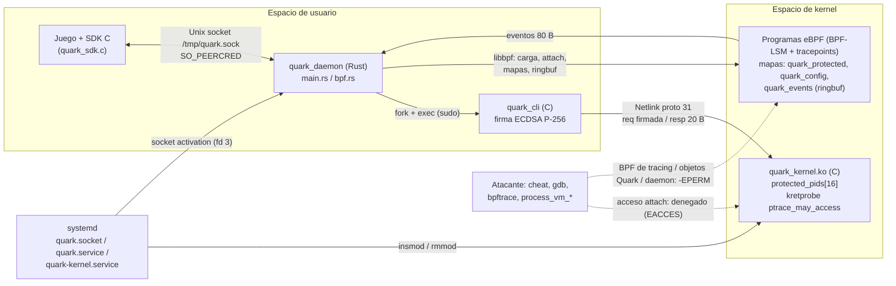

# CAPÍTULO IX — DISEÑO DE LA SOLUCIÓN

> **Alcance de la evidencia.** El código descrito se leyó (no se ejecutó) en el worktree de solo lectura `quark-wt/Dev`, commit `35c6031` (`origin/Dev`, 2026-11-05). Toda referencia `archivo:línea` apunta a ese commit. Lo medido en la máquina virtual proviene de `docs/vm_test_environment.md` de ese mismo commit y se cita como tal. Lo inferido sin lectura directa se marca **UNVERIFIED**. La rama `feature/gameStartProtection` (commit `2b088ab`) no está integrada y se describe aparte (§9.9).

Este capítulo cubre los puntos del Art. 24.3.9 del Reglamento: arquitectura del sistema de información (§9.1), diseño de solución (§9.2 y §9.3), modelo de datos (§9.4), infraestructura de comunicaciones y servidores (§9.5), entornos de trabajo (§9.6) y solución (§9.7 a §9.9).

## 9.1. Arquitectura del sistema de información

### 9.1.1. Componentes

El sistema se compone de cuatro piezas de código propio más dos binarios de apoyo, escritos en tres lenguajes.

| Componente | Lenguaje | Ruta | Función |
|---|---|---|---|
| Módulo de kernel `quark_kernel` v0.4.0 | C | `kernel/quark_kernel.c:42,44` | Autoridad sobre qué PID está protegido; bloquea accesos de nivel *attach* con un `kretprobe`; recibe órdenes por Netlink. |
| Demonio `quark_daemon` | Rust (edición 2024) | `quark_daemon/src/main.rs`, `quark_daemon/Cargo.toml:4` | Atiende al juego por socket Unix, ordena la protección al kernel, supervisa variables, carga los programas eBPF. |
| Programas eBPF | C | `quark_daemon/src/bpf/quark.bpf.c` | 12 programas BPF-LSM y de tracepoint (ver §9.3.3); se cargan con `libbpf-rs` 0.27 (`quark_daemon/Cargo.toml:14`). |
| Cargador/esqueleto BPF | Rust | `quark_daemon/src/bpf.rs`, `quark_daemon/build.rs:15` | Compila el objeto BPF en tiempo de build (`libbpf-cargo` 0.27, `Cargo.toml:18`) y lo carga y adjunta en el arranque. |
| `quark_cli` | C | `quark_daemon/quark_cli.c` | Firma las órdenes y las envía por Netlink al kernel. |
| SDK | C | `sdk/quark_sdk.c`, `sdk/quark_sdk.h` | Biblioteca enlazada en el juego; API pública y *watchdog*. |

El juego de prueba (`game_target/game.c`), la herramienta de ataque (`cheat/cheat.c`) y el motor RecoilEngine (submódulo) son entornos de validación, no componentes del producto.

### 9.1.2. Diagrama de arquitectura



Fuentes de cada flecha: socket y credenciales (`sdk/quark_sdk.c:11`, `quark_daemon/src/main.rs:110-133`); invocación de `quark_cli` (`main.rs:202-204`); Netlink (`quark_daemon/quark_cli.c:16,145`, `kernel/quark_kernel.c:46,612`); carga eBPF (`bpf.rs:184-269`); activación por socket (`main.rs:25-42`, `quark_daemon/systemd/quark.socket:5`); carga del módulo (`quark-kernel.service:26-27`).

### 9.1.3. Principio de autoridad dividida

El módulo de kernel decide qué PID está protegido. El mapa BPF `quark_protected` es un espejo que el demonio escribe solo después de que el kernel confirma con `ok=1` (`quark_daemon/src/bpf.rs:1-6`, `quark.bpf.c:21-24`, `main.rs:250-264`). El juego solo recibe la confirmación a través del demonio.

## 9.2. Diseño de la solución: flujos

### 9.2.1. Flujo de protección (arranque protegido)

```mermaid
sequenceDiagram
  autonumber
  participant J as Juego + SDK
  participant SD as systemd
  participant D as quark_daemon
  participant CLI as quark_cli
  participant K as quark_kernel.ko
  participant E as eBPF (LSM + tracepoints)

  Note over SD,K: quark-kernel.service (oneshot) ya hizo insmod del .ko
  J->>SD: connect(/tmp/quark.sock)
  SD->>D: arranca quark.service, pasa el socket como fd 3 (LISTEN_FDS)
  D->>CLI: sudo quark_cli 3 <pid_demonio> (registrar monitor de confianza)
  CLI->>K: Netlink tipo 3, firmado
  K-->>CLI: respuesta {ok}
  D->>E: load_and_attach(daemon_tgid): escribe quark_config, adjunta, completa link_ids
  J->>D: CMD_REGISTER_GAME(pid declarado)
  D->>D: SO_PEERCRED: pid real (el declarado no se usa)
  D->>CLI: sudo quark_cli 1 <pid_real>
  CLI->>K: Netlink tipo 1 {pid, nonce, firma}
  K->>K: uid root, SHA-256 de /proc/pid/exe, nonce fresco, firma ECDSA
  K->>K: quark_protect_pid(): rechaza si hay hipervisor (build release)
  K-->>CLI: respuesta {ok, is_testing_build, version}
  CLI-->>D: stdout QUARK_OK / QUARK_VERSION / QUARK_TESTING_BUILD
  D->>E: protect(pid): quark_protected[pid]=1; quark_protected_count
  D-->>J: ack de 19 bytes [ok][testing][version16][bpf_lsm_active]
  J->>J: quark_sdk_init(): ok=1 requerido; inicia watchdog
  D->>D: hilo monitor: lee /proc/pid/mem cada 50 ms
```

Referencias por paso: 1-2 (`main.rs:16,25-42`; `quark.socket:5`); 3-4 (`main.rs:549-569`; `quark_cli.c:120-259`; `quark_kernel.c:591-595`); 5 (`main.rs:575-585`; `bpf.rs:184-269`); 6-7 (`sdk/quark_sdk.c:133-139`; `main.rs:110-133,181-197`); 8-9 (`main.rs:202-204`; `quark_kernel.c:557-580`); 10-11 (`quark_kernel.c:220-271,557-578,334-349`); 12-13 (`quark_kernel.c:354-390`; `quark_cli.c:255-259`; `main.rs:213-234`); 14 (`main.rs:254-264`; `bpf.rs:272-282`); 15 (`main.rs:51-67,272`); 16 (`sdk/quark_sdk.c:147-187`); 17 (`main.rs:290-303,422-506`).

Decisiones observables en el flujo:

- El PID usado contra el kernel proviene de `SO_PEERCRED`, no del *payload*; si difiere, solo se registra una nota (`main.rs:181-197`).
- Si `quark_cli` falla (módulo ausente o rechazo), el demonio envía el ack con `ok=0` y corta la conexión (`main.rs:236-241,272,284-288`); el SDK devuelve `-1` y el juego debe negarse a continuar (`sdk/quark_sdk.c:149-157`, `sdk/quark_sdk.h:26-29`).
- La carga eBPF es de mejor esfuerzo: si falla, el demonio continúa con solo el `kretprobe` y reporta `bpf_lsm_active=0` (`main.rs:571-585,254-264`; `sdk/quark_sdk.c:169-173`).

### 9.2.2. Flujo de comandos firmados (canal de control)

Tres órdenes cambian estado y pasan por la misma puerta (`quark_kernel.c:513-523`): `1` proteger, `2` desproteger, `3` registrar el monitor de confianza (`quark_cli.c:120-143`). Secuencia de verificación en el kernel (`quark_nl_recv_msg`, `quark_kernel.c:524-600`):

1. Tipo de mensaje válido (1, 2 o 3) y carga útil de tamaño suficiente (`:533-548`).
2. `quark_check_sender()`: uid del emisor tomado de `NETLINK_CREDS(skb)`, no del campo `nlmsg_pid`; debe ser root; se abre `/proc/<pid>/exe`, se calcula SHA-256 (tope 1 MiB, `:49,181-205`) y se compara con `quark_cli_expected_sha256` (`:220-271`).
3. `quark_nonce_is_fresh()`: el nonce debe ser estrictamente mayor que `last_nonce` (`:158-166`).
4. `quark_verify_signature()`: ECDSA P-256 (`crypto_alloc_sig("x962(ecdsa-nist-p256)")`) sobre SHA-256 de `{comando(1 B), pid(4 B), nonce(8 B)}` (`:127-152,566-571`) con la clave pública compilada (`kernel/quark_pubkey.h:9`, 65 bytes SEC1).
5. Solo entonces avanza el nonce (`:170-177,580`) y se ejecuta la orden (`:582-599`).

Las respuestas existen solo para 1 y 3; la 2 no tiene respuesta (`:537-540`, `quark_cli.c:223-227`). El nonce del cliente es la hora en nanosegundos (`quark_cli.c:176-178`). La firma se genera con OpenSSL EVP y la clave privada de `/opt/quark-anticheat/keys/quark_signing_key.pem` (`quark_cli.c:21,56-103`); el par de claves de prueba lo crea `tooling/keys/generate-testing-key.sh`. El hash de `quark_cli` se regenera en cada build (`Makefile:85-89`), por lo que el `.ko` queda atado al binario compilado en ese momento.

### 9.2.3. Flujo de bloqueo en el kernel

`ptrace_may_access` se engancha con un `kretprobe` (`quark_kernel.c:506-511,620-621`). El *entry handler* guarda `task` y `mode` desde los registros `di` y `si` (`:427-438`, solo `CONFIG_X86_64`). El *return handler* fuerza `regs->ax = 0` (acceso denegado) cuando se cumplen simultáneamente (`:489-499`):

- el objetivo es un PID protegido (`is_pid_protected`, `:470`);
- el llamador no es el propio proceso ni `trusted_monitor_pid` (comparación por `tgid`, `:467-468,489`);
- el modo incluye `PTRACE_MODE_ATTACH` (`:491`).

Los accesos de solo lectura (`PTRACE_MODE_READ`) pasan sin alteración (`:409-417,484-488`). No existe exención general para root (`:476-483`).

### 9.2.4. Flujo de telemetría y autoprotección (eBPF)

Los eventos se escriben en el *ring buffer* `quark_events` (`quark.bpf.c:83-86,138-155`); un hilo del demonio los consume cada 250 ms y los imprime como líneas `[QUARK-BPF]` (`bpf.rs:233-255,101-140`). Las acciones bloqueantes devuelven `-EPERM` (§9.3.3). Los programas de ejecución y de carga de módulos se omiten si `quark_protected_count == 0` (`quark.bpf.c:166-167,360-361,375-376`).

### 9.2.5. Flujo de supervisión de variables (capa suplementaria)

Tras el ack, el SDK puede registrar variables (`CMD_REGISTER_VAR`) y declarar actualizaciones legítimas (`CMD_UPDATE_VAR`). El hilo monitor del demonio compara cada 50 ms el valor de `/proc/<pid>/mem` con el esperado; ante diferencia imprime la alerta y ejecuta `kill -9` sobre el proceso (`main.rs:462-497`, en particular `:463,480,490`). Esta capa lee memoria protegida y por eso depende de que el demonio esté registrado como monitor de confianza (`main.rs:540-569`).

### 9.2.6. Flujo de fin de sesión

Cuando el cliente cierra el socket, el demonio ejecuta `quark_cli 2 <pid>` y retira el PID del espejo BPF (`main.rs:404-417`). Además, el tracepoint `sched_process_exit` borra la entrada si el líder de grupo termina (`quark.bpf.c:388-402`), lo que evita que un PID reutilizado herede protección. Del lado del SDK, el *watchdog* sondea el socket cada 1 s y llama a `_exit(137)` si el demonio se cae (`sdk/quark_sdk.c:18,63-111`).

## 9.3. Diseño de solución: interfaces

### 9.3.1. Interfaz Netlink (kernel ↔ `quark_cli`)

- Familia `AF_NETLINK`, `SOCK_RAW`, protocolo **31** (`NETLINK_QUARK`), definido en `kernel/quark_kernel.c:46` y `quark_daemon/quark_cli.c:16`; el kernel crea el socket con `netlink_kernel_create` (`quark_kernel.c:604-617`).
- `nlmsg_type` ∈ {1, 2, 3} (`quark_cli.c:204`; `quark_kernel.c:531-533`).
- Solicitud `struct quark_netlink_request` (`quark_kernel.c:55-60`; espejo manual en `quark_cli.c:30-35`):

| Campo | Tipo | Significado |
|---|---|---|
| `pid` | `s32` | PID objetivo (o PID del demonio para el comando 3) |
| `nonce` | `u64` | Hora en ns; estrictamente creciente |
| `sig_len` | `u16` | Longitud real de la firma DER, ≤ 72 |
| `sig` | `u8[72]` | Firma ECDSA P-256 DER |

- Respuesta `struct quark_protect_response` (`quark_kernel.c:68-73`; `quark_cli.c:38-43`): `ok:u8`, `is_testing_build:u8`, `reserved[2]`, `version[16]`. El kernel responde por `nlmsg_unicast` al `nlmsg_pid` del solicitante (`:354-390`). `quark_cli` espera como máximo 3 s (`quark_cli.c:49,162-169`) y traduce la respuesta a líneas `QUARK_OK:`, `QUARK_VERSION:`, `QUARK_TESTING_BUILD:` en la salida estándar (`:255-257`), que el demonio extrae (`main.rs:217-223`).
- Tamaño de la solicitud en memoria: 96 bytes por alineación natural de `u64` (cálculo propio, no medido con `sizeof`; **UNVERIFIED**). El mensaje firmado ocupa 13 bytes sin relleno (`quark_kernel.c:528`).
- Código de retorno de `quark_cli`: 0 si `ok=1`; 1 en cualquier otro caso (`quark_cli.c:259`).

### 9.3.2. Interfaz de socket Unix (SDK ↔ demonio)

- Ruta `/tmp/quark.sock` (`sdk/quark_sdk.c:11`; `main.rs:509`), `SOCK_STREAM`, modo `0666` impuesto por systemd (`quark.socket:9`).
- Trama: cabecera de 8 bytes `[command:u32][payload_len:u32]` en *endianness* nativo, más *payload* (`sdk/quark_sdk.c:35-56`; `main.rs:153-168`).

| Comando | Valor | Payload | Respuesta |
|---|---|---|---|
| `CMD_REGISTER_GAME` | 1 | `pid:i32` (4 B) | ack de 19 B |
| `CMD_REGISTER_VAR` | 2 | `address:u64`, `size:u32`, `name:char[32]` (44 B) | ninguna |
| `CMD_UPDATE_VAR` | 3 | `address:u64`, `new_value:u64` (16 B) | ninguna |

Fuentes: `main.rs:45-47,171-397`; `sdk/quark_sdk.c:13-15,189-232`.

- Ack de registro, 19 bytes: `[ok:1][is_testing_build:1][version:16][bpf_lsm_active:1]` (`main.rs:49-67`; `sdk/quark_sdk.c:31-33,159-162`). El mismo diseño se mantiene a mano en ambos extremos.
- El demonio autentica al cliente con `SO_PEERCRED` (`main.rs:105-133`); el socket es escribible por cualquier usuario, de modo que el PID declarado en el *payload* no es confiable (`main.rs:138-144`).

### 9.3.3. Interfaz eBPF (demonio ↔ programas)

Doce programas, enumerados en `quark.bpf.c` (conteo de `SEC("...")` sin licencia ni mapas):

| Tipo | Sección | Línea | Efecto |
|---|---|---|---|
| Bloqueo | `lsm/bpf_prog_load` | 163 | Deniega cargar BPF de tracing (kprobe, tracepoint, perf_event, raw_tracepoint, tracing, LSM, ext) con PID protegido, salvo el demonio |
| Bloqueo | `lsm/bpf_map` | 191 | Deniega fd de mapas de Quark a terceros |
| Bloqueo | `lsm/bpf_prog` | 205 | Ídem para programas |
| Bloqueo | `lsm/bpf` (`BPF_LINK_GET_FD_BY_ID`) | 223 | Ídem para enlaces |
| Bloqueo + telemetría | `lsm/ptrace_access_check` | 254 | Deniega todo acceso al demonio; reporta intentos *attach* a PID protegidos |
| Telemetría | `tp/syscalls/sys_enter_process_vm_readv` y `..._writev` | 289, 301 | `PROCESS_VM_ACCESS` |
| Telemetría | `lsm/file_mprotect` | 319 | `EXEC_MPROTECT` (anónimo + `PROT_EXEC`, sin bloqueo) |
| Telemetría | `lsm/task_kill` | 338 | `TASK_KILL` |
| Telemetría | `tp/module/module_load` | 358 | `MODULE_LOAD` |
| Telemetría | `tp/sched/sched_process_exec` | 373 | `EXEC` |
| Mantenimiento | `tp/sched/sched_process_exit` | 388 | Borra el PID del mapa |

El demonio verificó en la VM la carga de 12 programas, 4 mapas y 12 enlaces (`docs/vm_test_environment.md` §15.4, ejecución del 2026-09-30, núcleo 7.0.9 con `vmlinux.h` generado en otro núcleo).

Orden de arranque de la autoprotección (`bpf.rs:178-232`): se cargan los objetos; se leen ids de mapas y programas; se escribe `quark_config`; se adjunta; se consultan los ids de enlaces y se reescribe `quark_config`. El orden garantiza que `quark_bpf_map` conozca qué proteger antes de entrar en servicio (`bpf.rs:182-183`).

### 9.3.4. API pública del SDK (`sdk/quark_sdk.h`)

| Función | Línea (.h) | Comportamiento |
|---|---|---|
| `int quark_sdk_init(void)` | 31 | Conecta, registra el PID, exige `ok=1` y lanza el *watchdog*; `-1` ante cualquier falla (`sdk/quark_sdk.c:113-187`) |
| `int quark_sdk_register_var(void*, uint32_t, const char*)` | 40 | Opta una variable por monitoreo; nombre de hasta 31 caracteres (`sdk/quark_sdk.c:189-213`) |
| `int quark_sdk_update_var(void*, uint64_t)` | 48 | Declara una escritura legítima (`:215-232`) |
| `int quark_sdk_is_active(void)` | 59 | 1 si el socket sigue abierto (`:234-239`) |
| `int quark_sdk_is_testing_build(void)` | 71 | 1 si el módulo es de *testing* (`:241-247`) |
| `int quark_sdk_is_bpf_lsm_active(void)` | 84 | 1 si los ganchos BPF-LSM cubren el proceso (`:249-255`) |
| `int quark_sdk_get_version(char*, size_t)` | 94 | Versión del módulo (`:257-275`) |
| `void quark_sdk_close(void)` | 99 | Cierra la conexión (`:277-285`) |

Los valores devueltos por `is_*` son calculados en el proceso del cliente. Un cliente adulterado puede falsificarlos (Informe, Update 2026-11-13 §E; no hay atestación verificada por servidor, `docs/features.md:254-256`).

## 9.4. Modelo de datos

El sistema no usa base de datos ni persistencia. Todo el estado reside en memoria y se pierde al descargar el módulo o terminar el demonio (`quark_kernel.c:155-157`). Se distinguen cuatro grupos.

### 9.4.1. Estado del módulo de kernel

| Dato | Declaración | Notas |
|---|---|---|
| `protected_pids[16]`, `protected_pids_count` | `quark_kernel.c:274-275` (tope en `:47`) | Protegido por `quark_lock` (`:276`). Alta rechazada con aviso si se llena (`:319-322`) |
| `trusted_monitor_pid` | `:283` | Una sola ranura, inicial `-1` |
| `last_nonce`, `quark_nonce_lock` | `:88-89` | Anti-repetición; se reinicia al recargar el módulo |
| `quark_pubkey[65]` | `kernel/quark_pubkey.h:9` | Clave pública ECDSA P-256 compilada |
| `quark_cli_expected_sha256[32]` | generado (`Makefile:85-89`), no versionado | Hash esperado del emisor |

### 9.4.2. Mapas y variables BPF

| Objeto | Tipo | Clave → valor | Capacidad | Línea |
|---|---|---|---|---|
| `quark_protected` | `BPF_MAP_TYPE_HASH` | `u32` tgid → `u8` | 16 | `quark.bpf.c:53-58` |
| `quark_config` | `BPF_MAP_TYPE_ARRAY` | `u32` 0 → `struct quark_config` | 1 | `:66-81` |
| `quark_events` | `BPF_MAP_TYPE_RINGBUF` | — | 256 KiB | `:83-86` |
| `quark_protected_count` | variable global (`.bss`) | `u32` | — | `:93` |

`struct quark_config` (`:66-74`) contiene `daemon_tgid`, `map_ids[8]`, `map_id_count`, `prog_ids[16]`, `prog_id_count`, `link_ids[16]`, `link_id_count`. Los topes se repiten en Rust (`bpf.rs:23-27`) y la compilación falla si no coinciden con el tipo generado. El demonio es el único escritor de `quark_protected_count`; el BPF solo lo decrementa al salir un proceso (`bpf.rs:297-306`; `quark.bpf.c:397-400`).

### 9.4.3. Estado del demonio

`QuarkState { pid, variables: HashMap<u64, MonitoredVar>, is_active }` y `MonitoredVar { address, size, name, expected_value }` (`main.rs:69-81`), uno por conexión y compartido entre el hilo del cliente y el monitor mediante `Arc<Mutex<…>>` (`main.rs:150-151,290-299`). Del lado BPF mantiene `HashSet<u32>` con los PID espejados (`bpf.rs:167-170`).

### 9.4.4. Formato de eventos

Definido en `quark_daemon/src/bpf/quark_events.h` y duplicado a mano en Rust (`bpf.rs:29-55`; el encabezado lo declara en `quark_events.h:1-7`).

```c
struct quark_event {                       // quark_events.h:27-35
    unsigned long long timestamp_ns;       // bpf_ktime_get_ns()
    unsigned int type;                     // enum quark_event_type
    unsigned int pid;                      // tgid del actor
    unsigned int target_pid;               // tgid protegido, 0 si no aplica
    unsigned int aux;                      // modo ptrace / señal / tipo de prog BPF / prot / id
    char comm[16];                         // QUARK_COMM_LEN
    char modname[56];                      // QUARK_MODNAME_LEN, solo MODULE_LOAD
};
```

Tamaño: 8 + 4×4 + 16 + 56 = **96 bytes** (`bpf.rs:42-43`; el parseo rechaza registros más cortos, `bpf.rs:68-71`). Desplazamientos usados en el lector: `comm` en 24, `modname` en 40 (`bpf.rs:72-73`).

Tipos de evento (`quark_events.h:12-22`): 1 `EXEC`, 2 `PTRACE_ATTEMPT`, 3 `PROCESS_VM_ACCESS`, 4 `EXEC_MPROTECT`, 5 `TASK_KILL`, 6 `MODULE_LOAD`, 7 `BPF_PROG_DENIED`, 8 `BPF_OBJ_DENIED`, 9 `DAEMON_ACCESS_DENIED`. El significado de `aux` por tipo se declara en `quark_events.h:32`; el demonio lo presenta en texto en `bpf.rs:102-140`. Formato de salida: una línea `[QUARK-BPF] <TIPO>: …` por evento (p. ej. `bpf.rs:106-109`); el catálogo completo de mensajes está en `docs/log_messages.md`.

Los eventos no se persisten, no se firman y no se envían a un servidor: se imprimen en la salida estándar del demonio (`bpf.rs:237`), que en el servicio systemd va al *journal* (`docs/vm_test_environment.md` §3.2).

## 9.5. Infraestructura de comunicaciones y servidores

El sistema opera de forma local, sin servidores propios. Los canales son tres, todos dentro del equipo del jugador:

| Canal | Mecanismo | Autenticación |
|---|---|---|
| SDK ↔ demonio | Socket Unix de flujo, `/tmp/quark.sock`, `0666` | `SO_PEERCRED` (pid real del par) |
| demonio → kernel | `quark_cli` + Netlink proto 31 | uid root, SHA-256 del ejecutable, firma ECDSA, nonce |
| demonio ↔ eBPF | `bpf()` por `libbpf-rs`; ring buffer | Solo el demonio tiene acceso a los objetos (`lsm/bpf_*`) |

Servicios systemd (`quark_daemon/systemd/`):

- `quark.socket`: `ListenStream=/tmp/quark.sock`, `SocketMode=0666`, `RemoveOnStop=true`, instalado en `sockets.target` (`quark.socket:5,9,10,13`).
- `quark.service`: `Requires=`/`After=quark.socket`, `Type=simple`, `ExecStart=/opt/quark-anticheat/quark_daemon/target/release/quark_daemon`, `User=root` (`quark.service:3-4,7,9,13`). No tiene sección `[Install]` propia: se arranca por activación del socket (`quark.service:15-18`, comentario; `main.rs:14-42`).
- `quark-kernel.service`: `Type=oneshot`, `RemainAfterExit=yes`, `insmod` idempotente en `ExecStart` y `rmmod` en `ExecStop` (`quark-kernel.service:15-16,26-27`). No impone orden respecto del socket; la falla de carga queda cubierta por el protocolo de ack (`quark-kernel.service:3-13`).

Limitaciones de infraestructura observables en el código:

- El demonio atiende **un cliente a la vez**: `handle_client` se invoca de forma síncrona dentro del bucle `incoming()` (`main.rs:587-592`) y retorna solo cuando el cliente se desconecta (`main.rs:155-168,404-419`). El efecto sobre un segundo juego concurrente no se midió (**UNVERIFIED**); el tope de 16 PID del kernel no es alcanzable con un único cliente activo. `quark_cli` documenta la misma restricción (`quark_cli.c:45-48`).
- Las rutas `./quark_daemon/quark_cli` y `/opt/quark-anticheat/keys/quark_signing_key.pem` están fijas en el código (`main.rs:203,411,551`; `quark_cli.c:21`). El demonio invoca `sudo` aunque corre como root (`main.rs:202`).
- No hay empaquetado DKMS: el módulo se compila contra el núcleo en uso (`docs/vm_test_environment.md` §3.1; `kernel/Makefile:3`).

## 9.6. Entornos de trabajo

### 9.6.1. Entorno de pruebas (VM)

Según `docs/vm_test_environment.md` §1: máquina virtual local **QEMU/KVM** accesible por SSH, con **Nobara Linux 43 (KDE Plasma)**, núcleo `7.0.9-200.nobara.fc43.x86_64`, partición raíz de 23 GB, usuarios `quark` y `root`. La distribución se declara referencia del proyecto (`docs/contexto_proyecto.md`, citada allí). El equipo anfitrión usa Arch Linux y solo construye contenedores desechables Fedora 44 para compilar los plugins de IA (`vm_test_environment.md` §1, §6; `tooling/recoil-fedora-build/`).

Discrepancia declarada: `vm/README.md:1-11` describe otra VM, **CachyOS** con núcleo `7.3.1-1-cachyos` compilado con clang, introducida en el commit `38d49cd`. Cuál es el entorno vigente a la fecha **UNVERIFIED**; el Makefile del módulo cubre ambos casos agregando `LLVM=1` si el núcleo se compiló con clang (`kernel/Makefile:6-8`; commit `2058e28`).

La VM obliga a usar el módulo de *testing*: el build de *release* rechaza proteger bajo un hipervisor porque lee el bit CPUID de hipervisor (`quark_kernel.c:79-86,334-349`; `kernel/Makefile:21-22`; `Makefile:98-100`). El build de *testing* se declara a sí mismo con `is_testing_build=1` (`quark_kernel.c:362-366`). Toda la evidencia de la VM corresponde por lo tanto a un build de *testing*.

### 9.6.2. Requisitos de ejecución

- BPF-LSM requiere `bpf` en `/sys/kernel/security/lsm` (parámetro de arranque `lsm=`) (`docs/vm_test_environment.md` §15.1; `quark_daemon/src/main.rs:571-585`).
- `vmlinux.h` se genera con `bpftool` desde el BTF del equipo de compilación y no se versiona; las relocalizaciones CO-RE permiten usar el objeto en otro núcleo (`Makefile:25-29`; `build.rs:10-14`; verificado en la VM, §9.3.3).
- La compilación del módulo exige encabezados del núcleo en uso (`kernel/Makefile:3`, `docs/vm_test_environment.md` §2.1).

### 9.6.3. Construcción

`make daemon` (`Makefile:16-18`) construye `quark_cli` (enlaza `-lcrypto`, `Makefile:33-35`) y `cargo build --release`. `make kernel` y `make kernel-testing` generan `kernel/quark_cli_hash.h` y compilan el módulo (`Makefile:85-100`). El linter (`make lint`) ejecuta `clang-tidy` sobre el código C del SDK, `quark_cli`, el módulo y los programas de prueba (`Makefile:72-79`).

## 9.7. Decisiones de diseño

| Decisión | Motivo documentado | Fuente |
|---|---|---|
| Módulo de kernel en C, no Rust | Contingencia del riesgo R2 (bindings insuficientes), prevista en §5.7 del informe | Informe, Update 2026-11-13 §B |
| `kretprobe` en lugar de gancho LSM en el módulo | Un módulo fuera del árbol no puede registrar LSM: `security_add_hooks()` es `__init` y no se exporta | `quark.bpf.c:7-9` |
| Ganchos LSM mediante BPF-LSM desde el demonio | Única forma de obtener LSM reales; además cubre BPF de tracing, que no pasa por `ptrace_may_access` | `quark.bpf.c:3-15` |
| Bloquear solo `PTRACE_MODE_ATTACH` | Los accesos de lectura saturaban `dmesg` y afectaban `ps`/`htop` sin impedir lecturas de memoria | `quark_kernel.c:409-417` |
| Compara `tgid`, no `pid` de hilo | Un hilo no líder o el hilo monitor del demonio fallaban la comparación | `quark_kernel.c:459-468` |
| Una única ranura de monitor de confianza, sin exención a root | Una exención general de root dejó pasar al `cheat` en una prueba real | `quark_kernel.c:476-483` |
| Mensajes firmados con nonce, hash del emisor y uid | Se hallaron dos fallas de escalada local durante el desarrollo | `docs/features.md:155-163` |
| El espejo BPF solo se actualiza tras el `ok=1` del kernel | Una sola fuente de verdad | `bpf.rs:1-6` |
| Falla cerrada | `quark_sdk_init()` exige confirmación; el *watchdog* termina el proceso | `sdk/quark_sdk.h:11-31`; `sdk/quark_sdk.c:63-111` |
| Build de *release* sin camino de bypass compilado | Un build de prueba no puede hacerse pasar por *release* | `quark_kernel.c:326-333` |
| Activación por socket de systemd | El demonio solo corre mientras se usa, como `docker.socket` | `main.rs:14-24` |
| Eventos de telemetría no bloqueantes (`EXEC_MPROTECT`) | Los JIT legítimos también cambian `PROT_EXEC` | `quark.bpf.c:313-318` |

## 9.8. Límites del diseño

Declarados en el código o en `docs/features.md`; ninguno fue medido por esta redacción más allá de lo citado.

1. **Lecturas de nivel *read* por root.** `/proc/<pid>/{environ,maps,auxv}` quedan legibles para cualquier proceso con `CAP_PERFMON`, porque `mm_access()` los concede después de que `ptrace_may_access()` se niega. Se expone el diseño de memoria (ASLR). No puede anularse desde un módulo (`docs/features.md:44-53`; `quark.bpf.c:248-253`; `vm_test_environment.md` §15.5).
2. **Escrituras sin llamada al sistema.** Una inyección por `LD_PRELOAD` o DLL que no use `ptrace`/`/proc/mem` no se observa; `EXEC_MPROTECT` es solo un indicador (Informe, Update 2026-11-13 §B).
3. **BPF-LSM de mejor esfuerzo.** Si el usuario arranca sin `bpf` en `lsm=`, quedan solo el `kretprobe` y el SDK lo informa con `bpf_lsm_active=0` (`main.rs:571-585`; `sdk/quark_sdk.h:73-84`). El motor RecoilEngine aún no aplica política sobre ese valor (`docs/features.md:260-262`).
4. **Atestación del cliente.** `quark_sdk_is_*` se calculan en el cliente; no existe SDK de servidor ni prueba cliente-servidor de punta a punta (`docs/features.md:252-259`).
5. **Capacidad.** 16 PID en el kernel y en `quark_protected` (`quark_kernel.c:47`; `quark.bpf.c:55`), 8/16/16 objetos propios en `quark_config` (`quark.bpf.c:47-49`) y un cliente activo por vez en el demonio (§9.5).
6. **Efectos colaterales mientras hay un PID protegido.** `bpftrace`, `perf trace` con BPF y la carga de programas de tracing fallan (`docs/features.md:125-127`; `quark.bpf.c:157-187`).
7. **Pérdida de estado.** Al recargar el módulo se reinician `protected_pids` y `last_nonce` (`quark_kernel.c:155-157`); no hay persistencia.
8. **Arquitectura.** El *entry handler* solo extrae argumentos en x86_64; en otras arquitecturas deja `task = NULL` y no bloquea nada (`quark_kernel.c:430-436`).
9. **Clave de firma.** El par de claves es de prueba, sin almacenamiento seguro, rotación ni distribución; la raíz de confianza para una versión productiva es un problema abierto (`tooling/keys/generate-testing-key.sh:1-15`; Informe, Update 2026-11-13 §E).
10. **Lecturas de memoria del propio demonio.** El hilo monitor no puede leer un proceso si el demonio no corre como root (`main.rs:437-459`). Un comentario de ese bloque (`main.rs:447-450`) todavía menciona una exención a root que el kernel ya no aplica (`quark_kernel.c:476-483`): discrepancia de documentación, sin efecto en la ejecución.
11. **Documentación desactualizada.** `docs/funcionamiento_codigo.md:13` atribuye al módulo ganchos LSM sobre `ptrace_access_check`, y `docs/funcionamiento_codigo.md:9-11` describe solo el prototipo de espacio de usuario; el código real usa `kretprobe` y canal firmado. Para este capítulo se tomó el código (R12 del registro de riesgos).
12. **Sobrecarga.** No se midió el costo en rendimiento de los ganchos (R14 del Informe).

## 9.9. Solución: estado e integración

Estado de las ramas al 2026-11-13 (Informe, Update §F): la solución descrita está integrada en `Dev@35c6031`. La rama `feature/gameStartProtection` (`2b088ab`, 4 commits sobre `35c6031`) no está integrada y agrega, según `git diff --stat`: `tooling/install.sh` (instalador que copia a `/opt/quark-anticheat` y habilita las unidades; avisa si falta BPF-LSM, `tooling/install.sh:1-22`), un cambio en `game_target/game.c` para que el juego de prueba se niegue a iniciar si `quark_sdk_init()` falla o si `quark_sdk_is_bpf_lsm_active()` es 0, y una reescritura de `run_test_no_quark.sh`. Esa política de rechazo no existe en `Dev`, donde el juego de prueba continúa sin protección (`game_target/game.c:40-43` en `Dev`). Dado que la rama no está integrada, queda fuera de la solución descrita arriba.

Validación respaldada por documentación (no repetida por esta redacción; alcance: VM, build de *testing*): bloqueo del `cheat` con RecoilEngine real y control negativo con el módulo descargado (`docs/vm_test_environment.md` §7); *watchdog* con retardo observado de ~5,5 s (§8); 12 programas BPF cargados y comprobaciones de autoprotección (§15.4). Falta medir tasa de detección, falsos positivos y sobrecarga.

---

*Firma: agent:claude-sonnet-5-5 — 2026-11-25. Borrador sujeto a revisión humana; no sustituye al Cap. IX del informe hasta ser aceptado por el equipo.*
