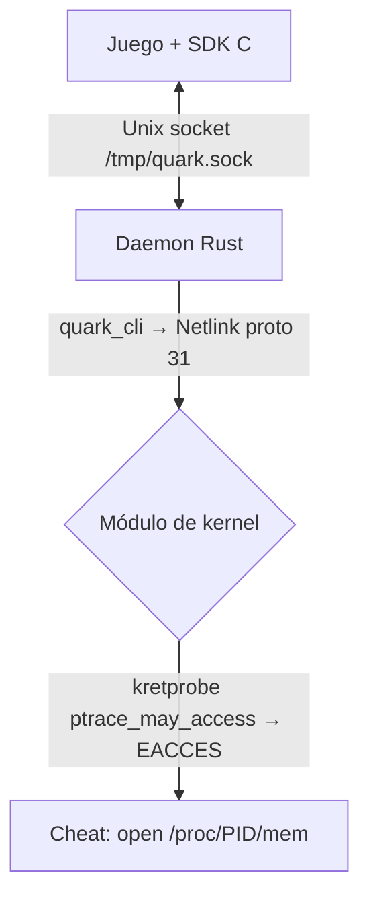

# Arquitectura — visión general

| Componente | Lenguaje | Ruta | Detalle |
|---|---|---|---|
| Módulo de kernel | C | `kernel/quark_kernel.c` | kretprobe sobre `ptrace_may_access()`, lista de 16 PIDs |
| Daemon | Rust | `quark_daemon/src/main.rs` | registra el juego, ordena protección, monitor de memoria (Modo A) |
| `quark_cli` | C | `quark_daemon/quark_cli.c` | traduce órdenes a Netlink |
| SDK | C | `sdk/quark_sdk.{c,h}` | registro de variables + watchdog fail-closed |
| Juego mock / cheat | C | `game_target/`, `cheat/` | objetivo y atacante de prueba |
| Motor real | C++ | `RecoilEngine/` (submódulo) | parcheado con el SDK; juego Beyond All Reason |

## Modos de protección (no simultáneos)
- **Modo A** (sin módulo): detección reactiva por polling cada 50 ms + `kill -9`.
- **Modo B** (con módulo): prevención en Ring 0; deniega `open()` con `EACCES`, incluso al propio daemon.

Detalle completo, protocolo IPC y procedimiento de prueba: [[Funcionamiento-del-codigo]]. Mensajes de log: [[Log-messages]]. Qué no cubre: [[Known-Limitations]]. Contexto/objetivos: [[Contexto-del-proyecto]].

## Update 2026-11-11 — agent:claude — alinear con origin/Dev@35c6031

- **ADDED** — El daemon ahora carga **programas BPF-LSM + telemetría** (`quark_daemon/src/bpf.rs`, `src/bpf/quark.bpf.c`, libbpf-rs): bloquea cargas de programas BPF de tracing, protege los objetos BPF y al propio daemon, y emite eventos `[QUARK-BPF]` ([[Features]] §1.5–1.6).
- **ADDED** — El canal de control kernel↔daemon↔CLI tiene 4 capas: uid de Netlink verificado por el kernel, hash SHA-256 de `quark_cli`, comandos firmados ECDSA P-256 con nonce, y registro de un único `trusted_monitor_pid` ([[Features]] §2). Clave pública compilada en el módulo (`kernel/quark_pubkey.h`); privada fuera del repo.
- **ADDED** — Atestación al SDK: `ok`, `is_testing_build`, `version`, `bpf_lsm_active` en un ack de 19 bytes ([[Features]] §3). Módulo en v0.4.0.
- **ADDED** — Unidades systemd: `quark.socket`, `quark.service`, `quark-kernel.service` (oneshot insmod/rmmod).
- **REPLACES** — «Modo B (con módulo): prevención en Ring 0; deniega `open()` con `EACCES`, incluso al propio daemon.» → deniega solo accesos de nivel *attach* y exime al daemon registrado ([[Known-Limitations]] Update 2026-11-11).
- **REPLACES** — «Modo A (sin módulo): detección reactiva» como modo autónomo → capa suplementaria; el SDK no arranca sin protección de kernel confirmada.
- Diagrama vigente: `Juego+SDK ⇄(Unix socket, SO_PEERCRED)⇄ Daemon(Rust) ─quark_cli, Netlink firmado→ Módulo kernel (kretprobe)` y `Daemon ─libbpf→ BPF-LSM/telemetría`.
